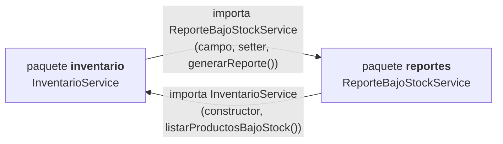
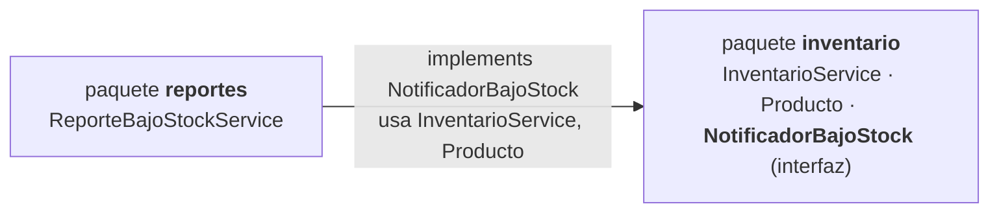

# Post-contenido U11 — Refactorización Guiada por Pruebas

**Code Smells, Paquetes y Acoplamiento en un Proyecto Java Real** · Patrones de Diseño de Software · Unidad 11

Autor: Juan Pablo Guerrero Hernández · Repositorio: `Guerrero-post1-u11`

Un único proyecto Maven (`com.universidad:refactoring-u11`, Java 17, Spring Boot 3.5.16) que contiene las dos partes de la actividad:

| Parte | Tema | Evidencia principal |
|---|---|---|
| 1 | Pruebas de caracterización + refactorización de un *Long Method* y de un *Switch Statement* duplicado | Sección [Parte 1](#parte-1--red-de-seguridad-y-refactorización-guiada-por-evidencia) |
| 2 | Dependencia cíclica entre paquetes detectada con ArchUnit y resuelta con inversión de dependencias | Sección Parte 2 (más abajo) |

```bash
mvn test        # suite completa
```

---

## Parte 1 — Red de seguridad y refactorización guiada por evidencia

### Orden real de los commits (la red de seguridad precede al refactor)

| # | Commit | Qué demuestra |
|---|---|---|
| 1 | `feat: crear inventario con Long Method ... y switch duplicado ...` | Código original con los dos smells |
| 2 | `test: agregar pruebas de caracterizacion antes de refactorizar (red de seguridad)` | 31 pruebas en verde sobre el código **sin refactorizar** |
| 3 | `refactor: eliminar Long Method en actualizarInventario ...` | Smell 1 eliminado, pruebas intactas |
| 4 | `refactor: eliminar switch duplicado sobre TipoProducto con polimorfismo` | Smell 2 eliminado, pruebas intactas |

Verificación de que **ninguna prueba se modificó después del commit 2** (salida vacía = sin diferencias):

```bash
git diff p1-caracterizacion HEAD -- src/test/java/com/universidad/refactoringu11/inventario
```

### Pruebas de caracterización

Se instancian directamente (`new InventarioService()`), sin levantar Spring, y se escribieron y ejecutaron en verde **antes** de tocar `InventarioService`, `ClasificadorProducto` o `EtiquetadoProducto`.

| Clase de prueba | Pruebas | Qué cubre |
|---|---|---|
| `InventarioServiceTest` | 19 | Los 4 retornos del enunciado (OK, datos inválidos, stock insuficiente, reorden), producto inexistente, `productoId` nulo, cantidad cero, tipo en minúsculas, stock **exactamente igual** al mínimo (no reordena), mínimo −1 (reordena), stock cero, entrada que sigue bajo el mínimo, varios productos, y la salida por consola (registro de auditoría y orden `registro → ALERTA`) |
| `ClasificadorProductoTest` | 7 | Las 4 ramas del switch + recargo fijo independiente del precio + precio cero + tipo nulo |
| `EtiquetadoProductoTest` | 5 | Las **4** ramas del switch (el enunciado traía solo 2: se agregaron ROPA y ALIMENTO porque el checkpoint exige las cuatro) + tipo nulo |
| **Total** | **31** | |

> **Por qué 31 y no 12.** Las pruebas del enunciado se conservan tal cual; se añadieron casos límite y las ramas faltantes *antes* de refactorizar. Una de ellas documenta un comportamiento heredado y cuestionable que **se preservó a propósito**: solo la rama `SALIDA` valida que el stock no quede negativo, de modo que una `ENTRADA` con cantidad negativa deja el stock en negativo sin error (`entrada_conCantidadNegativa_noValidaStockNegativo_comportamientoActual`). Un refactor ingenuo que validara `nuevoStock < 0` para ambos tipos habría cambiado el comportamiento; la prueba lo habría detectado. Lo mismo aplica a `tipoMovimiento == null`, que sigue lanzando `NullPointerException` (el refactor no corrige defectos, solo estructura).

### Smell 1 — Long Method en `InventarioService.actualizarInventario()`

**Técnica elegida (Fowler):** *Extract Method* (composición de métodos), más *Replace Magic Number with Symbolic Constant* (`3` → `FACTOR_REORDEN`, `"ENTRADA"/"SALIDA"` → constantes).

| Métrica | Antes (commit 1) | Después (commit 3) |
|---|---|---|
| Líneas del método (firma a llave de cierre) | **44** (32 sin blancos ni comentarios) | **9** |
| Responsabilidades mezcladas en un bloque | **6** (validación, búsqueda, actualización de stock, cálculo de reorden, auditoría, alerta) | **1** (orquestar) |
| Complejidad ciclomática del método | **12** (6 `if`, 1 `for`, 2 `\|\|`, 1 `&&`, 1 `?:`) | **5** (3 `if` + 1 `?:`) |
| Complejidad ciclomática máxima de un método del servicio | 12 | 5 |
| Cobertura de pruebas del método | 0 % al crear el proyecto | cubierto por 19 pruebas |

Método resultante (9 líneas):

```java
public String actualizarInventario(Long productoId, int cantidad, String tipoMovimiento) {
    if (!sonDatosValidos(productoId, cantidad, tipoMovimiento)) return "ERROR_DATOS_INVALIDOS";
    Producto producto = buscarProducto(productoId);
    if (producto == null) return "ERROR_PRODUCTO_NO_EXISTE";
    if (excedeStockDisponible(producto, cantidad, tipoMovimiento)) return "ERROR_STOCK_INSUFICIENTE";
    producto.setStock(calcularNuevoStock(producto, cantidad, tipoMovimiento));
    registrarMovimiento(producto, cantidad, tipoMovimiento);
    return necesitaReorden(producto) ? alertarBajoStock(producto) : "OK_" + producto.getStock();
}
```

Métodos extraídos, cada uno con una única responsabilidad: `sonDatosValidos` (validación), `buscarProducto` (búsqueda), `excedeStockDisponible` y `calcularNuevoStock` (regla de stock), `necesitaReorden` y `calcularCantidadReorden` (política de reorden), `registrarMovimiento` (auditoría) y `alertarBajoStock` (notificación).

El refactor se hizo en tres etapas (validación y búsqueda → stock → reorden/registro/alerta) ejecutando `mvn test` entre cada una: las tres veces **31 pruebas, 0 fallos**.

#### Decisión de diseño 1 — ¿método privado o clase `CalculadoraReorden`?

**Decisión: método privado `calcularCantidadReorden(Producto)` dentro de `InventarioService`.**

- **No tiene una razón de cambio propia hoy.** La fórmula es una sola expresión (`stockMinimo * 3 - stock`), depende únicamente de datos del `Producto` y tiene un único llamador. Una clase colaboradora de una línea sería *Speculative Generality*: más archivos, más indirección y ningún beneficio actual.
- **Costo concreto para este proyecto.** Una clase colaboradora tendría que crearse con `new` dentro del servicio o inyectarse. Inyectarla por constructor cambiaría la firma que usan las pruebas (`new InventarioService()`), y la Parte 2 depende justamente de no tocarla.
- **El nombre y la constante ya comunican la intención.** `calcularCantidadReorden` y `FACTOR_REORDEN` eliminan el número mágico sin añadir una abstracción.
- **Criterio para promoverla a clase:** si aparecen políticas de reorden distintas (por proveedor, por temporada, por tipo de producto), si otra clase necesita la misma regla, o si hace falta probarla aislada con varias estrategias. En ese momento tendría razón de cambio propia y pasaría a ser una clase (o una estrategia).

### Smell 2 — Switch Statement duplicado sobre `TipoProducto`

**Técnica elegida (Fowler):** *Replace Conditional with Polymorphism*, implementada con un `enum` que declara un método abstracto por comportamiento y una implementación por constante.

**Evidencia del smell (commit 1).** `ClasificadorProducto.calcularRecargoEnvio` y `EtiquetadoProducto.generarEtiqueta` contenían un `switch` de 8 líneas cada uno. Al normalizar lo que retorna cada rama (`case X: return ...` → `case X:`) y comparar línea a línea, **las 8 líneas del esqueleto son idénticas: 100 % de duplicación estructural** (4 `case`, `default`, `throw` y cierre). Agregar un tipo nuevo exigía acordarse de editar **dos** clases.

| Métrica | Antes (commit 1) | Después (commit 4) |
|---|---|---|
| `switch` sobre `TipoProducto` en `main` | **2** (uno por clase) | **0** |
| Cadenas `if-else` sobre el tipo | 0 | **0** |
| Ramas `default` / `throw` inalcanzables | 2 | **0** (el compilador garantiza la cobertura) |
| Líneas de `ClasificadorProducto` / `EtiquetadoProducto` | 16 / 16 | **8 / 8** |
| Clases a modificar para agregar un tipo nuevo | 3 (el enum + las 2 clases) | **1** (solo el enum) |
| Firmas `calcularRecargoEnvio(Producto)` y `generarEtiqueta(Producto)` | — | **sin cambios** |

Comprobación mecánica de que no queda ningún condicional sobre el tipo:

```bash
grep -rnE "switch|case |else" src/main/java   # sin resultados
```

Resultado:

```java
public class ClasificadorProducto {
    public double calcularRecargoEnvio(Producto producto) {
        return producto.getTipo().calcularRecargoEnvio(producto.getPrecio());
    }
}
public class EtiquetadoProducto {
    public String generarEtiqueta(Producto producto) {
        return producto.getTipo().generarEtiqueta(producto.getNombre());
    }
}
```

Para agregar, por ejemplo, `JUGUETE`, basta con añadir una constante a `TipoProducto`: el compilador obliga a implementar ambos métodos y `ClasificadorProducto` / `EtiquetadoProducto` no se tocan.

El enum recibe primitivos (`precio`, `nombre`) y no un `Producto`, para no crear una dependencia circular de clases entre `Producto` ↔ `TipoProducto`.

#### Decisión de diseño 2 — ¿enum con métodos abstractos o interfaz de estrategia?

**Decisión: enum con un método abstracto por comportamiento.**

- **El conjunto de tipos es cerrado y estable** en este dominio (libro, electrónico, ropa, alimento). El enum modela exactamente eso, y como `Producto` ya guarda un `TipoProducto`, el despacho es directo (`producto.getTipo().x()`), sin mapa de estrategias, sin registro y sin cableado.
- **Seguridad en compilación.** Si se agrega una constante y se olvida un comportamiento, el código no compila. Con una interfaz de estrategia habría que mantener además un `Map<TipoProducto, Estrategia>` y un olvido solo se descubriría en ejecución.
- **Menos piezas:** un solo archivo (el enum) frente a una interfaz de estrategia más una clase por cada tipo (cinco archivos) y el registro que las conecte.
- **Costo asumido.** El enum concentra reglas de precio y de presentación, lo que lo hace menos cohesivo, y sus constantes **no pueden recibir colaboradores inyectados por Spring**. **Cuándo cambiaría la decisión:** si cada tipo llegara a necesitar servicios inyectados (consulta de tarifas, impuestos por región, catálogo externo) o si los tipos pasaran a configurarse en tiempo de ejecución, migraría a una interfaz de estrategia con un `@Component` por tipo. La refactorización inversa sería mecánica porque los llamadores solo conocen `calcularRecargoEnvio(Producto)` y `generarEtiqueta(Producto)`.

### Resultado de `mvn test` antes y después de cada refactorización

| Momento | Commit / estado | Pruebas | Resultado |
|---|---|---|---|
| Red de seguridad sobre el código original | `p1-caracterizacion` (sin refactorizar) | 31 (19 + 7 + 5) | ✅ 0 fallos, 0 errores |
| Tras extraer validación y búsqueda | etapa A del commit 3 | 31 | ✅ 0 fallos |
| Tras extraer la regla de stock | etapa B del commit 3 | 31 | ✅ 0 fallos |
| Tras extraer reorden, registro y alerta | commit `p1-long-method` | 31 | ✅ 0 fallos |
| Tras reemplazar el switch por polimorfismo | commit `p1-switch` | 31 | ✅ 0 fallos |

```
[INFO] Tests run: 7,  Failures: 0, Errors: 0, Skipped: 0 -- in ...ClasificadorProductoTest
[INFO] Tests run: 5,  Failures: 0, Errors: 0, Skipped: 0 -- in ...EtiquetadoProductoTest
[INFO] Tests run: 19, Failures: 0, Errors: 0, Skipped: 0 -- in ...InventarioServiceTest
[INFO] Tests run: 31, Failures: 0, Errors: 0, Skipped: 0
[INFO] BUILD SUCCESS
```

---

## Parte 2 — Diagnóstico y resolución de acoplamiento entre paquetes

### Paso 1 — El módulo de reportes introduce el acoplamiento

Se agregó el paquete `reportes` (`ReporteBajoStockService`) y se hizo que `InventarioService` lo notifique al detectar bajo stock, mediante un colaborador opcional inyectado por *setter* (`@Autowired(required = false)`), tal como indica el enunciado. Para que el reporte tenga contenido real, `InventarioService` expone `listarProductosBajoStock()` y `generarReporte()` arma un texto plano con los productos por debajo del mínimo.

Resultado de `mvn test` tras el commit del módulo: **31 pruebas, 0 fallos**. El guard `reporteBajoStockService != null` evita el `NullPointerException` en las pruebas, que instancian `InventarioService` sin ese colaborador. **Compila, las pruebas pasan y el diseño ya está roto.**

### Paso 2 — Diagnóstico con una prueba de arquitectura

`ArquitecturaPaquetesTest` usa ArchUnit (`slices().matching("com.universidad.refactoringu11.(*)..").should().beFreeOfCycles()`).

**Diagrama de paquetes ANTES (con el ciclo):**



```
  inventario  ────────────────────►  reportes
  (dominio)   ◄────────────────────  (infraestructura)
        dos flechas en sentidos opuestos = CICLO
```

**Salida de `mvn test -Dtest=ArquitecturaPaquetesTest` en este punto (en rojo):**

```
[ERROR] Tests run: 1, Failures: 1, Errors: 0, Skipped: 0 <<< FAILURE! -- in ...ArquitecturaPaquetesTest
Architecture Violation [Priority: MEDIUM] - Rule 'slices matching 'com.universidad.refactoringu11.(*)..'
should be free of cycles' was violated (1 times):
Cycle detected: Slice inventario ->
                Slice reportes ->
                Slice inventario
  1. Dependencies of Slice inventario
    - Field  InventarioService.reporteBajoStockService has type reportes.ReporteBajoStockService
    - Method InventarioService.setReporteBajoStockService(reportes.ReporteBajoStockService) has parameter of type ...
    - Method InventarioService.alertarBajoStock(Producto) calls reportes.ReporteBajoStockService.generarReporte()
  2. Dependencies of Slice reportes
    - Constructor ReporteBajoStockService.<init>(inventario.InventarioService) has parameter of type ...
    - Field  ReporteBajoStockService.inventarioService has type inventario.InventarioService
    - Method ReporteBajoStockService.generarReporte() calls inventario.InventarioService.listarProductosBajoStock()
[INFO] BUILD FAILURE
```

**Las pruebas de negocio de la Parte 1 siguen en verde a pesar del ciclo** (`InventarioServiceTest`, `ClasificadorProductoTest`, `EtiquetadoProductoTest`: 31 pruebas, 0 fallos). Es la evidencia de que el problema es de arquitectura y no de comportamiento: ni el compilador ni las pruebas de negocio lo ven.

> **Hallazgo adicional (ciclo de *beans*, distinto del ciclo de paquetes).** Con el diseño literal del enunciado, la aplicación **no arranca** (`APPLICATION FAILED TO START`): `ReporteBajoStockService` pide `InventarioService` por constructor e `InventarioService` pide `ReporteBajoStockService` por *setter*, y Spring Boot prohíbe las referencias circulares entre *beans*. Las pruebas no lo detectan porque no levantan Spring. Se resolvió con `@Lazy` en el parámetro del constructor de `ReporteBajoStockService` (se verificó con `mvn spring-boot:run` → `Started RefactoringU11Application`). `@Lazy` no elimina el ciclo de paquetes: eso se resuelve en el Paso 3.

### Paso 3 — Resolver el ciclo invirtiendo la dependencia

**Técnica:** Principio de Inversión de Dependencias. Se extrajo la interfaz `NotificadorBajoStock` en el paquete `inventario`; `InventarioService` depende solo de ella y `ReporteBajoStockService` la implementa.

**Diagrama de paquetes DESPUÉS (sin ciclo):**



```
  reportes  ─────────────────────►  inventario
  (infraestructura)                  (dominio, define NotificadorBajoStock)
        una sola flecha: reportes → inventario
```

Dentro del código, la inversión se ve así:

```
Antes:   InventarioService ──depende de──► ReporteBajoStockService      (dominio → infraestructura)
Después: InventarioService ──depende de──► NotificadorBajoStock ◄──implementa── ReporteBajoStockService
```

`InventarioService` ya **no importa ninguna clase de `reportes`** (comprobable con `grep -rn "reportes" src/main/java/com/universidad/refactoringu11/inventario` → sin resultados). La parte relevante:

```java
private NotificadorBajoStock notificador;           // abstracción, no implementación

@Autowired(required = false)
public void setNotificador(NotificadorBajoStock notificador) { this.notificador = notificador; }

private String alertarBajoStock(Producto producto) {
    int cantidadReorden = calcularCantidadReorden(producto);
    if (notificador != null) {
        notificador.notificar(producto, cantidadReorden);
    }
    System.out.println("ALERTA: " + producto.getNombre()
            + " bajo stock minimo. Reordenar " + cantidadReorden + " unidades.");
    return "OK_BAJO_STOCK_REORDEN_" + cantidadReorden;
}
```

`ReporteBajoStockService` implementa `notificar(...)` registrando la cantidad de reorden por producto, y `generarReporte()` combina esa información con los productos que `InventarioService` reporta hoy como bajo el mínimo.

**Salida de `mvn test -Dtest=ArquitecturaPaquetesTest` ahora (en verde):**

```
[INFO] Tests run: 1, Failures: 0, Errors: 0, Skipped: 0 -- in ...ArquitecturaPaquetesTest
[INFO] BUILD SUCCESS
```

#### Decisión de diseño 3 — ¿por qué `NotificadorBajoStock` vive en `inventario` y no en `reportes`?

**Porque `inventario` es, en este proyecto, el paquete de mayor nivel de abstracción**, y la regla de la Guía de Contenido (sección 4.3) es que *los paquetes de infraestructura dependen de dominio; dominio nunca depende de infraestructura*.

- **`inventario` es el dominio:** contiene las reglas de negocio (qué es un movimiento válido, cuándo hay bajo stock, cuánto reordenar). Existiría aunque no hubiera reportes.
- **`reportes` es infraestructura/presentación:** es una vista derivada que consume los datos del dominio y es intercambiable (mañana podría ser un correo, un SMS o un *webhook*).
- **Si la interfaz estuviera en `reportes`**, `InventarioService` tendría que importarla y el ciclo `inventario → reportes → inventario` reaparecería: se habría movido el problema sin resolverlo.
- **Al estar en `inventario`**, es el dominio quien declara *qué necesita* ("avísame cuando algo quede bajo el mínimo") y la infraestructura quien decide *cómo* cumplirlo. Se pueden agregar nuevas implementaciones sin modificar `inventario` (Open/Closed), y las pruebas del dominio usan una simple lambda como notificador (`InventarioNotificacionTest`) sin conocer `reportes`.
- La regla queda protegida por `ArquitecturaDireccionDependenciasTest` (`inventario` no puede depender de `reportes`) además de la ausencia de ciclos.

### Paso 4 — Confirmar con las pruebas de la Parte 1 que el comportamiento no cambió

Se volvió a ejecutar la suite completa sin modificar una sola línea de `InventarioServiceTest`, `ClasificadorProductoTest` ni `EtiquetadoProductoTest`:

```bash
git diff p1-caracterizacion HEAD -- src/test/java/com/universidad/refactoringu11/inventario/InventarioServiceTest.java \
                         src/test/java/com/universidad/refactoringu11/inventario/ClasificadorProductoTest.java \
                         src/test/java/com/universidad/refactoringu11/inventario/EtiquetadoProductoTest.java
# (sin salida: los tres archivos son idénticos a como se escribieron en la Parte 1)
```

```
[INFO] Tests run: 1,  Failures: 0 -- ArquitecturaDireccionDependenciasTest
[INFO] Tests run: 1,  Failures: 0 -- ArquitecturaPaquetesTest
[INFO] Tests run: 7,  Failures: 0 -- ClasificadorProductoTest      (Parte 1, sin modificar)
[INFO] Tests run: 5,  Failures: 0 -- EtiquetadoProductoTest        (Parte 1, sin modificar)
[INFO] Tests run: 5,  Failures: 0 -- InventarioNotificacionTest
[INFO] Tests run: 19, Failures: 0 -- InventarioServiceTest         (Parte 1, sin modificar)
[INFO] Tests run: 2,  Failures: 0 -- RefactoringU11ApplicationTests
[INFO] Tests run: 4,  Failures: 0 -- ReporteBajoStockServiceTest
[INFO] Tests run: 44, Failures: 0, Errors: 0, Skipped: 0
[INFO] BUILD SUCCESS
```

| Grupo | Pruebas | Estado |
|---|---|---|
| Caracterización de la Parte 1 (sin modificar) | 31 (19 + 7 + 5) | ✅ verde |
| Arquitectura (`ArquitecturaPaquetesTest`, `ArquitecturaDireccionDependenciasTest`) | 2 | ✅ verde |
| Nuevas de la Parte 2 (notificación, reporte, arranque de Spring) | 11 | ✅ verde |
| **Total** | **44** | ✅ **0 fallos** |

Como la inversión de dependencias no alteró ningún resultado, mensaje de consola ni efecto sobre el stock, **el comportamiento observable no cambió**. Además, `mvn spring-boot:run` arranca correctamente (`Started RefactoringU11Application`) y `RefactoringU11ApplicationTests` verifica el cableado real de Spring de punta a punta.

#### Decisión de diseño 4 — `notificar(Producto, int)` por evento frente a `notificar(List<Producto>)` por lote

**Decisión: una notificación por evento individual.**

- **Coincide con lo que el dominio sabe.** `actualizarInventario` procesa *un* movimiento a la vez y, como máximo, deja *un* producto bajo el mínimo. El evento natural es "este producto, esta cantidad de reorden". Un lote obligaría a `InventarioService` a acumular productos, a decidir cuándo vaciar el búfer y a guardar estado mutable adicional: una responsabilidad nueva que no le corresponde.
- **Firma mínima y sin acoplamiento temporal.** El implementador recibe todo lo que necesita (`Producto` y `cantidadReorden`) en cada llamada, no hay un "momento de enviar" que alguien deba recordar, y es fácil de probar (una lambda registra las llamadas).
- **No cierra la puerta al lote.** Quien necesite agrupar puede hacerlo *dentro de su implementación*: `ReporteBajoStockService` ya acumula los eventos y luego los presenta como un único reporte. El dominio emite hechos, la infraestructura decide cómo agruparlos.
- **Cuándo preferiría el lote:** cuando cada notificación sea cara o tenga efectos externos (correo, SMS, llamada HTTP) y muchos productos crucen el umbral a la vez: una importación masiva, una conciliación nocturna de miles de movimientos o un resumen diario de reorden para compras. Allí un envío por producto saturaría el canal y enviaría decenas de mensajes en lugar de uno consolidado, y un lote permitiría además tratarlo como una operación atómica. En ese caso se añadiría un segundo método (`notificarLote(List<...>)`) o un proceso programado que consulte `listarProductosBajoStock()`.

### Paso 5 — Resumen final

#### Historial de commits

| # | Parte | Commit | Tag |
|---|---|---|---|
| 1 | 1 | `feat: crear inventario con Long Method ... y switch duplicado ...` | `p1-original` |
| 2 | 1 | `test: agregar pruebas de caracterizacion antes de refactorizar (red de seguridad)` | `p1-caracterizacion` |
| 3 | 1 | `refactor: eliminar Long Method en actualizarInventario ...` | `p1-long-method` |
| 4 | 1 | `refactor: eliminar switch duplicado sobre TipoProducto con polimorfismo` | `p1-switch` |
| 5 | 1 | `docs: documentar evidencia de code smells, decisiones de diseno y resultado de pruebas` | `p1-docs` |
| 6 | 2 | `feat: agregar modulo de reportes con notificacion de bajo stock desde inventario` | `p2-reportes` |
| 7 | 2 | `test: agregar prueba de arquitectura que detecta ciclo ... (en rojo)` | `p2-arch-rojo` |
| 8 | 2 | `refactor: invertir la dependencia entre inventario y reportes extrayendo NotificadorBajoStock` | `p2-inversion` |
| 9 | 2 | `test: cubrir la notificacion por interfaz, el reporte, el arranque de Spring y la direccion de dependencias` | `p2-pruebas` |
| 10 | 2 | `docs: completar README con diagrama de paquetes antes/despues y decisiones de la Parte 2` | último commit |

#### Estructura final

```
src/main/java/com/universidad/refactoringu11/
├── RefactoringU11Application.java
├── inventario/   Producto · TipoProducto · InventarioService · ClasificadorProducto
│                 EtiquetadoProducto · NotificadorBajoStock
└── reportes/     ReporteBajoStockService            (reportes → inventario, única dirección)
src/test/java/com/universidad/refactoringu11/
├── ArquitecturaPaquetesTest · ArquitecturaDireccionDependenciasTest · RefactoringU11ApplicationTests
├── inventario/   InventarioServiceTest · ClasificadorProductoTest · EtiquetadoProductoTest · InventarioNotificacionTest
└── reportes/     ReporteBajoStockServiceTest
```

#### Resumen de decisiones de diseño

| # | Decisión | Elección |
|---|---|---|
| 1 | Reorden: ¿método privado o clase? | Método privado `calcularCantidadReorden` |
| 2 | Polimorfismo: ¿enum o estrategia? | Enum con un método abstracto por comportamiento |
| 3 | ¿Dónde vive `NotificadorBajoStock`? | En `inventario` (dominio) |
| 4 | Granularidad de la notificación | Por evento (`notificar(Producto, int)`) |

#### Notas y limitaciones conocidas

- Los dos comportamientos heredados cuestionables (una `ENTRADA` con cantidad negativa deja el stock en negativo, y `tipoMovimiento == null` lanza `NullPointerException`) **se preservaron a propósito**: la actividad es de refactorización, no de corrección de errores. El primero está fijado por una prueba de caracterización.
- `ReporteBajoStockService` guarda su estado en memoria y `InventarioService` usa colecciones no sincronizadas: es un laboratorio de diseño, no un servicio listo para concurrencia.
